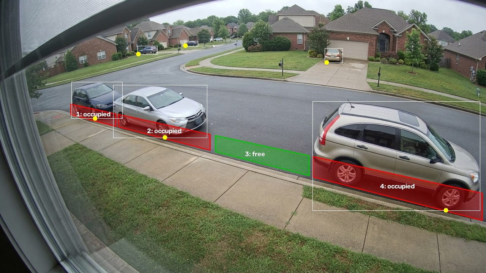

# Calibrating spots

Calibrating means outlining each curb spot on a picture from your camera. spotwatch decides a spot is
taken when a car's **ground point** (the lowest point of the car's outline, usually the tire nearest the
camera) lands inside that spot's outline. Good outlines matter more than any other setting.



*An AI-generated street, checked with `spotwatch.check --detect`. Each outline is a strip of road along
the curb, with its bottom edge just below the tires. The yellow dots are the ground points; each parked
car's dot lands inside its spot. Cars across the street have their dots far from any outline, so they
never count.*

## Before you start

- The camera is mounted where it will stay. If it moves later, you calibrate again.
- `config.yaml` exists (copy `config.example.yaml`) and `blink_camera` is set.
- Pick a moment with **good, even light** and **a few cars parked**. Parked cars show you where tires
  actually sit; low sun or dusk makes the picture hard to read and a poor reference (see below).

## Draw the outlines

```
uv run python -m spotwatch.calibrate --camera my-camera
```

This grabs a fresh picture (Blink can take 10 to 30 seconds) and opens a window. To draw on a picture you
already have, for example one saved with `--save-every`, add `--image runs/my-camera/20261019-120000.jpg`.

| Key | Does |
|---|---|
| left click | add a corner |
| right click | undo the last corner |
| Enter / Space | finish this spot (3+ corners); the terminal asks which spot id it is |
| `d` | delete a spot's outline on this camera |
| `s` | save |
| `q` / Esc | quit (asks if you have unsaved changes) |

Typing a new id in the terminal creates a new spot and asks for a name; that name is what alerts show.
Saving writes the outlines into `config.yaml` (your comments are kept) and stores the picture as
`calibration/<camera>.jpg`.

## What to outline

**Outline the road where the tires sit, not the car.** From a window the camera looks down at an angle,
so a parked car's body covers the road behind it in the picture. If you outlined the car body, a car in
the near spot would also seem to be in the spot behind it. The ground point avoids that: a car touches
the road in one place.

- **Follow the curb.** The outline is a strip along the curb, about as deep as a car is wide and as long
  as one parking space.
- **Use parked cars as a guide.** Put the bottom edge of each outline just below where the tires of a
  parked car meet the road.
- **Draw it low rather than high.** Outlines drawn too high in the picture are the most common mistake:
  the ground point lands just under the outline and the spot reads free with a car in it.
  `ground_tolerance_px` (default 10) forgives small misses. On far spots 10 pixels is less road, so draw
  those carefully.
- **Spots at the edge of the picture:** outline the part you can see. A car cut off by the edge of the
  picture has its ground point outside the frame, so that spot may often read unknown. Check it (below)
  before relying on it.
- **Spots behind something** (a pole, a tree, a van that is always parked in front): spotwatch can only
  judge what it can see. It may read unknown, or miss a car hidden behind the obstacle. Leave such a spot
  out, or accept that its alerts need a second look.

## Check the outlines

```
uv run python -m spotwatch.check --camera my-camera --detect
```

This takes one picture and saves it annotated: green = free, red = occupied, gray = unknown, and a yellow
dot on each car's ground point. Look at every spot:

- A car is parked but the spot is green: its ground point is just outside the outline. Redraw the
  outline lower, or a little bigger.
- A car in the next spot turns this one red: the outlines overlap or are drawn too deep. Shrink them.
- A spot is gray with nothing in front of it: a car's outline covers the spot but its ground point is
  elsewhere (often a car cut off at the edge of the picture).

Run it a few times over a day, or record with `python -m spotwatch --save-every 60` and replay the
pictures (see the README). One good picture is not proof.

## When the camera moves

spotwatch compares every picture with `calibration/<camera>.jpg`, matching the fixed background (houses,
poles), not cars.

- **Small wobble.** Blink cameras shift 10 to 20 pixels between pictures. Shifts up to
  `max_align_shift_px` (25 in `config.example.yaml`) are corrected by moving the outlines with the
  picture. The log says `camera shifted ~Npx; spot outlines aligned to the frame`. Nothing to do. If you
  set it to 0, any shift over `max_shift_px` (10) counts as a real move.
- **Real move.** A bigger shift rejects the picture with
  `camera moved ~Npx since calibration; rerun calibrate`. Every spot reads unknown, so no alerts are
  sent until you calibrate again.
- **Can't tell.** At night or in fog there may be too few background details to match. The picture is not
  rejected for that; the log notes `couldn't measure camera position`.

If you calibrated on a hazy or dark picture, matching will be poor all day. Calibrate again on a clear
one; the outlines can stay as they are (open the window, press `s`, quit).

If you get the moved message, run `calibrate` again. Your existing outlines show up; if the view only
moved a little, delete and redraw the spots that no longer line up, then save.
