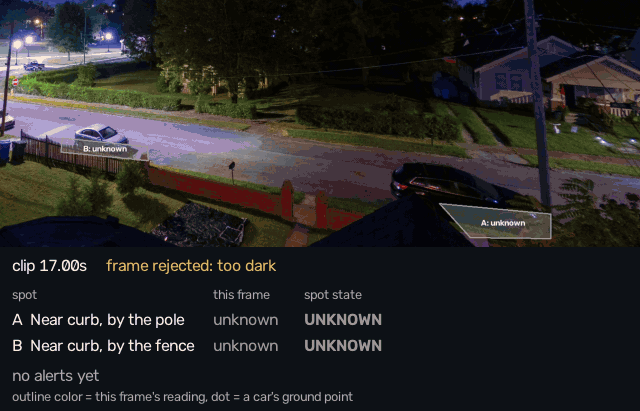
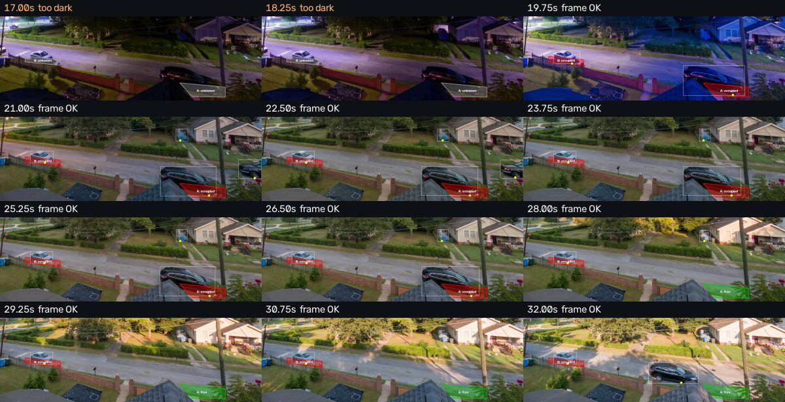

# The demo



This is SpotWatch's own output, not a mock-up. Every outline color, spot state and alert in the GIF
comes from the same `Runner` the live monitor uses: the frame quality gate, YOLO11s-seg, the spot
reading rules, fusion and the per-spot state machine. The renderer only reads the runner's state
after each poll and draws it. Alerts go to the in-memory notifier the tests use instead of the
console or Discord; the decision to alert is the same.

## The footage

- **Clip:** "Time-Lapse Video of a Street from Nighttime to Daytime", Pexels video 5332686
  (<https://www.pexels.com/video/time-lapse-video-of-a-street-from-nighttime-to-daytime-5332686/>)
- **Creator:** K ([@kelly on Pexels](https://www.pexels.com/@kelly/))
- **License:** [Pexels License](https://www.pexels.com/license/). The clip, the GIF and the stills
  made from it are covered by that license, not by this repository's AGPL-3.0.
- **File used:** the 2048x1080 rendition, SHA-256
  `e41b4d07ccb7f282bb6a8c789be21a900506ceb7078fad8eef39af0e2d2802c4`.

It's a stock timelapse of a stranger's street, chosen because it looks like SpotWatch's intended
setup: a fixed camera looking down at a street from an upper floor. It isn't the author's street.
The clip isn't stored in this repository.

## What happens

Two curb spots are outlined on the clip in [`scripts/demo-config.yaml`](../scripts/demo-config.yaml):
**A**, the near curb by the pole, and **B**, the near curb by the fence. Spot A is outlined only where
it's visible, because the roof in the foreground hides its left end. SpotWatch polls every 0.25 s
of clip time (61 polls from 17 s to 32 s). The full per-poll record, including every detection's
confidence and ground point, is in [`demo-readings.json`](demo-readings.json).

| Clip time | What SpotWatch did | Why |
|---|---|---|
| 17.00-18.50 s | Both spots **unknown**, no detection run | Quality gate: frames too dark (brightness below 40) |
| 18.75 s | Both read occupied; states stay **unknown** ("1/2 to confirm") | A spot is confirmed occupied after 2 occupied readings with no free reading between them (`occupied_frames: 2`) |
| 19.00 s | A confirmed **occupied**; B reads unknown | B's car scored 0.32, below `min_confidence` 0.35: a weak box on a spot makes it unknown, never free |
| 19.25 s | B confirmed **occupied** | Its second occupied reading. The unknown in between paused the count without resetting it |
| 26.75 s | A reads free, turns **FREE**, alert sent | The car's ground point is gone from spot A. The GIF then holds on the alert photo, cropped to the GIF's view |
| to 32.00 s | No further alerts | B stays occupied. A car that appears at 31.75 s has its ground point just left of A's outline, beside the stretch the roof hides, so A still reads free |

Twelve evenly spaced polls from the same run, with the quality gate's verdict, every detection (white
boxes) and each car's ground point (yellow dots):



## How the demo is set up

- **It starts at 17 s of a 32 s clip.** The clip opens at dusk (0-3 s), goes too dark, then brightens.
  The demo starts SpotWatch fresh at 17 s, as if the monitor were switched on then. Running the whole
  clip gives the same readings from 17 s on and the same alert at 26.75 s, plus an alert at 0 s
  (spot A is empty when the clip starts; a car then parks there). Both confirmations land at 18.75 s
  instead, because occupied readings from before the dark stretch still count: unknown readings
  pause the count rather than reset it.
- **The reference frame is the frame at 22 s.** `calibrate` normally saves the frame the outlines
  were drawn on, for the camera-moved check. The demo uses the frame at 22 s for the same purpose.
- **The poll interval is simulated.** The runner is told 60 s pass between polls. Readings are fresh
  at each simulated poll; clip seconds in the GIF are video time.
- **The spot outlines and the GIF's crop were chosen by hand** on this clip, the same way
  [`calibrate`](calibration.md) is used on a real camera. The crop only affects the picture;
  SpotWatch always sees the full frame.

## What it doesn't show

- **Real timing.** It's a timelapse: the car leaves between two frames, and the clip doesn't say how
  much real time each frame covers.
- **Accuracy.** One clip, two spots and one departure show how the pieces fit together, not how often
  they're right. [The design note](segmentation.md) has the measurements from a real installation
  and their limits.
- **Spots the camera can't fully see.** The car that appears at 31.75 s may be pulling into the end
  of spot A that the roof hides. SpotWatch can only judge the part of a spot it can see, so a camera
  position with a clear view of the whole curb matters more than any setting.

## Reproduce it

This is a manual run, not part of CI. Download the clip from the Pexels page above. The 2048x1080
size matches the outlines; other sizes are scaled automatically, but detections can differ
slightly. Then, from the repository root:

```
uv run python scripts/render_demo.py --video path/to/the-downloaded-clip.mp4
```

This needs `ffmpeg` on your PATH, and downloads `yolo11s-seg.pt` on first run. `uv run` installs the
locked versions from `uv.lock`. Different versions of the detection libraries, or a GPU instead of a
CPU, can shift detections slightly, so the report records the versions and device it ran with
(the committed one: ultralytics 8.4.183, torch 2.14.1 on CPU, OpenCV 5.0.0) and the clip's SHA-256.
It writes:

| File | What it is |
|---|---|
| `docs/images/demo.gif` | The GIF above |
| `docs/images/demo-montage.jpg` | The 12 polls above |
| `docs/demo-readings.json` | Every poll: frame verdict, detections, readings, states, alerts, plus versions and clip hash |

`--alert-out photo.jpg` also saves the full-size alert photo. `python scripts/render_demo.py --help`
lists the other options (time range, step, GIF size and colors).
